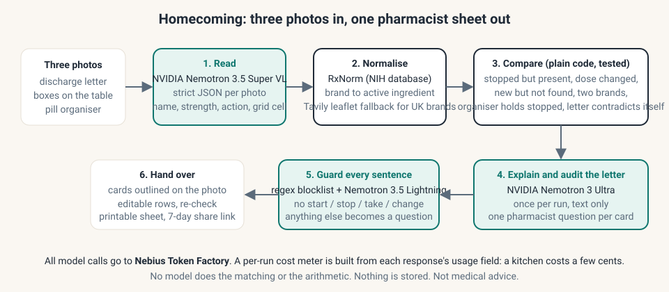

# Homecoming

**The weekend after a hospital discharge: photograph the letter, the boxes and the pill organiser, and see exactly where the house disagrees with the hospital. Every disagreement becomes a question for your pharmacist. It never tells you what to take.**

Live demo: **https://m-simakhov--homecoming-web.us-east.modal.run** (tap a sample kitchen, or photograph your own)
Demo video: <VIDEO_URL>
Track: **Best Apps and Agents**, Nebius x NVIDIA Global AI Hackathon 2026

> Not medical advice. Not a medical device. Nothing is stored. All demo data is synthetic.

## The problem

Friday: Dad comes home from hospital. The discharge letter stops one medicine, changes the dose of another and adds a third. Saturday morning: nine boxes and bottles are in the kitchen, the old pill organiser is still filled, and the GP surgery is closed until Monday. The carer does not need medical advice; they need to know **what to ask the pharmacist**, and they need it to be right.

Medicines reconciliation after discharge is a known failure point: the hospital's list, the home's cupboard and the organiser drift apart in the first 72 hours, and nobody has a side-by-side view. Homecoming gives the carer that view from three photos.

## What it does

1. **Reads** the letter, the boxes and the organiser with **NVIDIA Nemotron 3.5 Super VL** on Nebius Token Factory (strict JSON output, one call per photo, each item tagged with its position on a 3x3 grid so it can be outlined on the photo).
2. **Normalises** every printed name to its active ingredient with **RxNorm** (a free NIH database) so "Atorvatab 20 mg" and "Atorvastatin 20 mg" are recognised as the same medicine. UK-only brand names fall back to a **Tavily** search of official leaflet sites. No model guesses an ingredient; an unconfirmed name is flagged as such.
3. **Compares** the three lists in **plain, unit-tested Python**: stopped-but-still-in-the-house, dose-changed-but-old-strength-present, new-but-not-found, same-ingredient-two-brands, organiser-contains-stopped, not-on-the-letter, and letter-contradicts-itself. No model does the matching or the arithmetic.
4. **Explains** each disagreement and **audits the letter itself** with **NVIDIA Nemotron 3 Ultra**: contradictions ("stopped" and "continue" for the same drug), ambiguous wording ("as before", "reduce"), and one pharmacist question per card.
5. **Guards** every sentence with a regex blocklist and **NVIDIA Nemotron 3.5 Lightning**: nothing shown may tell anyone to start, stop, take, skip or change a medicine. Anything that slips is rewritten as a question.
6. **Hands over** a one-page printable pharmacist sheet, a 7-day share link for family (questions only, no photos), and a per-run cost meter that shows what each model call cost on Token Factory.

The carer can correct any misread row and re-check; the diff recomputes instantly.



## Why this split

| Step | Who | Why |
|---|---|---|
| Read photos | Nemotron 3.5 Super VL | multimodal, strict JSON, 1M context, $0.30/M input |
| Names to ingredients | RxNorm + Tavily | a database, not a model, must be right |
| Compare lists | Python with tests | deterministic, explainable, no hallucinated facts |
| Explain and audit | Nemotron 3 Ultra | the one place reasoning is needed; called once per run on text only |
| Guard | Nemotron 3.5 Lightning | fast and cheap, called per sentence |

A full kitchen costs a few cents. Nano/Lightning-class models handle the many cheap calls; Ultra runs once.

## Run it

```bash
git clone https://github.com/msimakhov-star/homecoming && cd homecoming
pip install "fastapi[standard]" pillow pytest
export NEBIUS_API_KEY=...      # from tokenfactory.nebius.com; omit to run in recorded mode
export TAVILY_API_KEY=...      # optional: leaflet fallback for UK brand names
python local.py                # http://localhost:8787
pytest                         # LIVE=1 pytest also hits RxNorm
```

Deploy (scale-to-zero on Modal, free tier):

```bash
modal secret create homecoming NEBIUS_API_KEY=... TAVILY_API_KEY=... --force
modal deploy app.py
```

Probe whether Super VL reads your own boxes well enough (prints HIT/MISS per item and a GO/NO-GO):

```bash
NEBIUS_API_KEY=... python scripts/probe.py            # on the synthetic sample kitchens
NEBIUS_API_KEY=... python scripts/probe.py photos/    # your photos + photos/truth.json
```

## Repository map

```
app.py                 Modal entrypoint (one ASGI container, Dict for limits/cache/share links)
local.py               run locally with uvicorn
homecoming/
  diff.py              the reconciliation engine (7 discrepancy types) and strength normalisation
  normalise.py         RxNorm lookup with strict name matching, UK name map, Tavily fallback
  llm.py               Token Factory client, exact model ids, cost meter
  prompts.py           JSON schemas and prompts for VL, Ultra and Lightning
  guard.py             regex blocklist + Lightning rewrite
  pipeline.py          photos -> rows -> items -> diffs -> cards -> sheet; recorded mode
  server.py            FastAPI app: /api/run, /api/reconcile, /api/ask, /api/share, samples
web/                   mobile-first UI, no build step
data/kitchens.json     three synthetic kitchens with ground truth
data/samples/          rendered letter, boxes and organiser images (scripts/make_samples.py)
scripts/probe.py       VL go/no-go probe
tests/                 diff engine and end-to-end tests
```

## Safety and privacy

- **No advice by construction**: the diff produces facts, Ultra is instructed to ask not advise, every user-facing string passes a regex blocklist and a Lightning policy check, and the free-text box can only answer by reframing as pharmacist questions.
- **Nothing stored**: photos go browser to server to Token Factory and are discarded. Share links hold the questions only, for 7 days.
- **Abuse limits in the app**: per-IP hourly cap, a daily USD budget, image size caps. When a limit is hit the app shows a recorded sample and says so.
- **Synthetic data only**: fictional hospital, fictional patient, fictional brand names on the sample boxes. No real letterheads, trusts or patients anywhere.
- **Known limits**: handwritten letters are not supported; curved or tiny labels may be misread (hence the editable rows); RxNorm is a US database, so some UK brands rely on the Tavily fallback or the carer's correction.

## Feedback on Nebius and NVIDIA tools

See [FEEDBACK.md](FEEDBACK.md).

## Licence

MIT.
